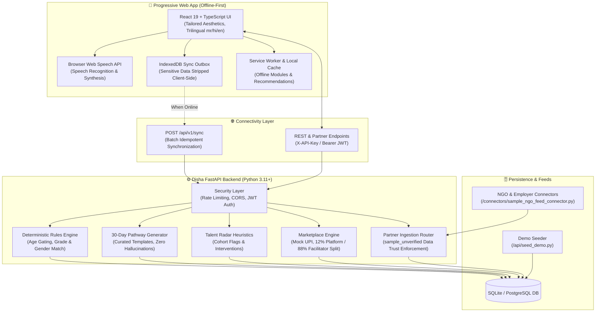

# Disha (दिशा) 🧭
### Voice-First, Multilingual, Offline-First AI Career & Livelihood Guide for Rural India

> Built for the Citi India Hackathon — *Reimagining Education & Economic Empowerment for Rural India*  
> **License:** [Apache-2.0](./LICENSE) • **Version:** `1.0.0`

---

## 🌟 What is Disha?
**Disha** is an open-source, mobile-first progressive web platform tailored for rural Indian learners (Standard 9th to Graduation) and village facilitators (teachers, NGO workers, and community volunteers).

Rural youth frequently lack visibility into practical livelihoods beyond conventional academia and rarely know which government scholarships, state schemes, or apprenticeships they are eligible for. Disha bridges this divide through:
- **Discover:** Voice-first student profiling in Marathi (`mr`), Hindi (`hi`), and English (`en`).
- **Matching:** Deterministic, zero-hallucination rules engine for verified schemes, apprenticeships, and scholarships with human-audited source URLs.
- **My Path:** Adaptive 30-day micro-step pathways providing vocational alternatives alongside competitive exam readiness.
- **Offline Sync:** Resilient IndexedDB outbox queue that runs seamlessly offline and syncs idempotently when connectivity resumes.
- **Facilitator Portal & Talent Radar:** Teachers manage cohorts via 6-character join codes, detect students needing intervention through heuristic radar flags, run shared-device sessions, and export privacy-preserving cohort reports.
- **Marketplace (12/88 Revenue Split):** Facilitators create practical localized skill modules; students enroll via simulated mock UPI payments and access lesson steps offline.
- **Open API & Connectors:** Partner API-key authentication and extensible connector feeds for NGOs and rural employers.

---

## 🏗️ Architecture Diagram



---

## 📸 Screenshots & Demonstrations

| Student Home (Trilingual) | Facilitator Portal & Radar | Marketplace & Revenue Split |
|:---:|:---:|:---:|
| *(Voice-first Discovery & Courses)* | *(Join Code, Radar Flags, CSV)* | *(12% Platform / 88% Facilitator)* |
| `[Screenshot Placeholder: Student Home]` | `[Screenshot Placeholder: Facilitator Dashboard]` | `[Screenshot Placeholder: Marketplace Course]` |

---

## 🔒 Honest Privacy & Limitations Disclosure

Disha operates under strict transparency regarding its prototype features and real-world boundaries:

1. **Voice Audio Processing via Browser Vendor**:
   - Voice input and text-to-speech rely on the client browser's native `webkitSpeechRecognition` and `speechSynthesis` APIs (processed by the browser vendor, e.g. Google Chrome or Apple WebKit).
   - Disha’s servers **never record, stream, or store student audio**.
2. **Prototype Authentication & Mock Payments**:
   - Facilitator login utilizes prototype phone OTP (in dev and demo mode, OTP is displayed on screen without an SMS gateway).
   - Course marketplace payments use simulated mock UPI payments (`PAID_MOCK`). No real banking credentials or gateways are involved.
3. **Data Trust Policy (`sample_unverified`)**:
   - All external feeds and unverified seed opportunities are strictly flagged as `sample_unverified` with `verified_by: null` and `verified_on: null`.
   - The verified badge and ranking bonus are awarded **only** after human verification via `/api/verify_report.py`.
4. **DPDP Act & Child Safety Compliance**:
   - Mandatory guardian consent checkbox is required before student profiles are created or synced.
   - **Sensitive attributes** (`annual_family_income`, `caste/social category`, `bank account details`) are stripped client-side and **never uploaded or stored in the database**.
   - Cohort CSV exports enforce **k-anonymity statistical disclosure control**: any aggregated student group count strictly below 5 is masked with `"<5"`.

---

## 🚀 Quick Start (One Command)

### Prerequisites
- Python 3.11+
- Node.js 18+ (Node 20 recommended)
- Git

### One-Command Local Startup

**Windows:**
```cmd
start.bat
```

**macOS / Linux:**
```bash
chmod +x start.sh
./start.sh
```

**Docker Compose:**
```bash
docker compose up --build
```

### Accessing Disha:
- **Web App (PWA)**: [http://localhost:5173](http://localhost:5173)
- **FastAPI Backend**: [http://127.0.0.1:8000](http://127.0.0.1:8000)
- **Interactive OpenAPI Documentation**: [http://127.0.0.1:8000/docs](http://127.0.0.1:8000/docs)
- **Health Check**: [http://127.0.0.1:8000/health](http://127.0.0.1:8000/health)

---

## 🧪 Testing

### Backend Test Suite (Pytest - 53 tests)
```bash
python -m pytest api/tests -v
```

### Frontend Test Suite (Node.js Test Runner - 14 tests)
```bash
npm --prefix web test
```

### Production Build Verification
```bash
npm --prefix web run build
```

---

## 📚 Documentation
- [`docs/RUN.md`](./docs/RUN.md) — Step-by-step local execution and verification instructions.
- [`docs/DEPLOY.md`](./docs/DEPLOY.md) — Cloud deployment guide (Vercel/Netlify for Web, Render/Railway for API).
- [`docs/CONNECTORS.md`](./docs/CONNECTORS.md) — Partner API key guide & NGO feed connector plugin instructions.
- [`docs/SPEC.md`](./docs/SPEC.md) — System specifications, data models, and architectural standards.
